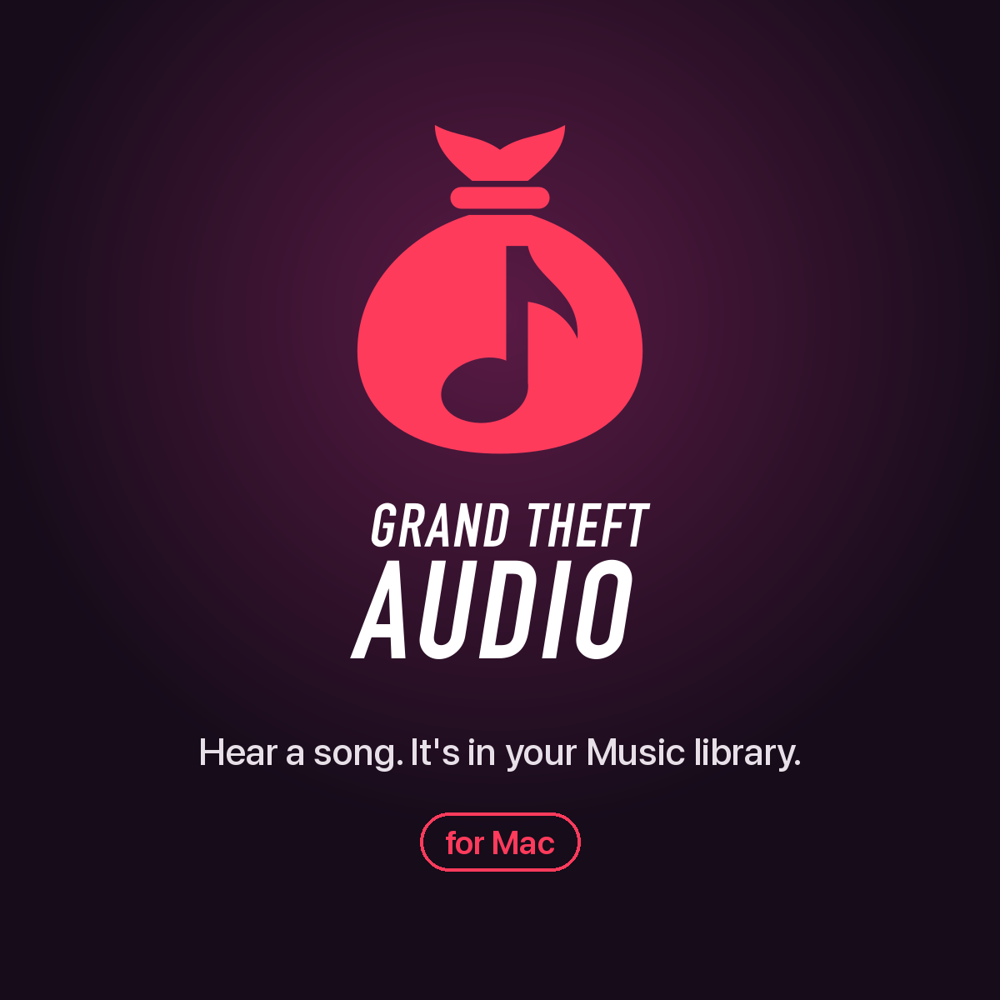

<p align="center">
  
</p>

# Grand Theft Audio

**Hear a song. It's in your Music library.**

A macOS Shortcut that listens to whatever's playing around you, recognizes it with
Shazam, finds the best upload of that song on YouTube, downloads it, tags it
properly (album, cover art, track number, year, genre, lyrics) and adds it to the
Music app, in whichever playlists you pick, all while you keep doing what you were doing.

- **One click.** Run it from the menu bar or a keyboard shortcut. A small floating orb
  listens, then shows the download progress.
- **Picks the right version.** Prefers the artist's official audio, skips live, cover,
  remix, slowed/sped-up and karaoke uploads, and matches the length of the album version.
- **Tagged like a purchase.** Shazam's exact artist and title, plus album, album artist,
  track/disc number, year, genre and the full-size album cover from the iTunes catalog, and
  lyrics from [LRCLIB](https://lrclib.net).
- **Playlists while you wait.** Pick one or more playlists (or make a new one) while
  the song downloads. Your recent ones are at the top.
- **No duplicates.** If you already have the song, it fills in any missing cover, lyrics
  or genre instead of downloading it again.
- **Keeps itself working.** No Homebrew needed: the first run installs everything it
  needs into its own folder. The YouTube downloader is updated weekly, and again
  automatically if a download fails.
- **Optional iPhone companion.** [Hear it Later](hear-it-later/README.md) Shazams a song on
  your phone and your Mac downloads it into your library.

## Requirements

- macOS 12 Monterey or later, Intel or Apple Silicon
- The Music app
- An internet connection. The first run downloads about 250 MB of tools (Python,
  [yt-dlp](https://github.com/yt-dlp/yt-dlp), ffmpeg).
- To build the shortcut from source: Python 3 and Xcode's command line tools
  (`xcode-select --install`)

## Install

```bash
git clone https://github.com/KobyKodes/grand-theft-audio.git
cd grand-theft-audio
python3 build_hearit_shortcut.py
open "Grand Theft Audio.shortcut"
```

Click **Add Shortcut**. That's it: the scripts are packed inside the shortcut, so you
can delete the cloned folder afterwards if you like.

> Without Xcode's command line tools the build still works, but the shortcut won't have
> the floating progress window (you'll get notifications instead).

### First run

The first time, macOS asks for a few permissions. Allow them all:

| Prompt | Why |
| --- | --- |
| Microphone | Shazam has to hear the song |
| Control "Music" | To add the song and put it in playlists |
| Notifications | To tell you when the song is in |
| *Run Shell Script* / *Run AppleScript* in Shortcuts | The shortcut is made of these steps. If Shortcuts says scripts aren't allowed, turn on **Shortcuts → Settings → Advanced → Allow Running Scripts**. |

The first run also installs its tools in `~/Library/Application Support/GrandTheftAudio`,
which takes a few minutes. A notification tells you when it's done.

## Use

1. Play the song near your Mac (or on it).
2. Run **Grand Theft Audio**: from the Shortcuts icon in the menu bar, from Spotlight, or
   with a keyboard shortcut (Shortcuts app → open the shortcut → ⓘ → **Add Keyboard
   Shortcut**).
3. The orb listens. When it knows the song, it shows the title and starts downloading.
4. Pick playlists in the window while it downloads, or skip.
5. A notification says **Clean getaway**, and the song is in Music.

Songs are saved to `~/Music/YoutubeDownloads` and then added to Music. If Music's
**Settings → Files → Copy files to Music Media folder when adding to library** is on,
Music keeps its own copy.

### When YouTube asks "confirm you're not a bot"

Now and then YouTube wants a signed-in browser. The shortcut then retries with your
Chrome login, and macOS asks once whether it may read Chrome's saved data: click
**Always Allow**. If you don't use Chrome, wait a few minutes and try again.

## Hear it Later (iPhone, optional)

Hear a song while you're out? Shazam it with the **Hear it Later** shortcut on your
iPhone, pick a playlist, and your Mac downloads it, either right away over your home
Wi-Fi or whenever it next sees the song in iCloud Drive. Setup is in
[hear-it-later/README.md](hear-it-later/README.md).

## More tools

These run from the cloned folder and need `yt-dlp`, `ffmpeg` and Python's `mutagen`
installed (`brew install yt-dlp ffmpeg && pip3 install mutagen`).

| Command | What it does |
| --- | --- |
| `./ytmusic.sh <youtube-url>` | Downloads one YouTube video as a tagged song (no Shazam). Set `YTMUSIC_DEST` to change the folder. |
| `./hearit.sh "<artist>" "<title>"` | What the shortcut does after Shazam: find, download, tag. |
| `./extras/backfill_tags.py` | Adds album, track numbers, year and full-size covers to songs you downloaded before. Previews first; `--apply` writes, `--undo` reverts. |
| `python3 extras/make_chime.py` | Generates an alternative success sound in `sounds/`. |

## Troubleshooting

- **Nothing happens / "Couldn't get …" notification.** The notification shows the reason.
  Run the shortcut again: if YouTube changed something, the downloader updates itself on the
  failure and retries.
- **"Shazam couldn't identify the song".** Get the Mac's microphone closer to the speaker,
  or turn the music up.
- **No floating window.** The shortcut was built without Xcode's command line tools.
  Install them (`xcode-select --install`), rebuild and re-import the shortcut.
- **First-run setup failed.** Check the internet connection and run the shortcut again. It
  picks up where it stopped.
- **Wrong version of a song.** Delete it from Music and from `~/Music/YoutubeDownloads`.
  For a specific upload, use `./ytmusic.sh <url>`.

## How it works

```
Shortcut ─┬─ hearit_setup.sh     unpack the scripts, install tools the first time, weekly yt-dlp update
          ├─ hearit_listen.sh    open the orb window (ytprogress)
          ├─ Shazam it           → "Artist|Title"
          └─ HearItOwnIt.applescript
                ├─ hearit.sh  ─┬─ hearit.py pick     search YouTube, score the results
                │              ├─ ytmusic.sh         download, cover, tags (tag_m4a.py)
                │              └─ hearit.py retag    Shazam names, album info from iTunes
                ├─ playlist picker (in the window, or a dialog)
                └─ Music: add the song, add it to playlists, notify
```

| File | Role |
| --- | --- |
| `build_hearit_shortcut.py` | Builds and signs `Grand Theft Audio.shortcut`, with every script packed inside |
| `HearItOwnIt.applescript` | The main flow: runs the download, asks for playlists, talks to Music |
| `hearit.sh`, `hearit.py` | Finds the song on YouTube and applies Shazam's names and iTunes album info |
| `ytmusic.sh`, `tag_m4a.py` | Downloads with yt-dlp, crops the cover, writes tags and lyrics, spots duplicates |
| `update_ytdlp.sh` | Keeps yt-dlp current (weekly, and after a failed download) |
| `ytprogress.swift` | The floating orb and progress window (AppKit, no dependencies) |
| `hearit_setup.sh`, `find_python.sh` | First-run install with [uv](https://github.com/astral-sh/uv), and finding the tools |
| `hear-it-later/` | [Hear it Later](hear-it-later/README.md): the queue, the Wi-Fi fast lane, the agent installer and the iPhone shortcut builder |
| `sounds/` | The success sounds (`owned.wav`, `owned2.wav`, alternating) |
| `extras/` | `backfill_tags.py` and `make_chime.py` (see [More tools](#more-tools)) |
| `brand/` | Logo files, icons and [usage guidelines](brand/GUIDELINES.md) |

## Development

```bash
bash tests/test_hearit_queue.sh     # queue tests (no downloads, Music isn't touched)
python3 build_hearit_shortcut.py    # rebuild after changing any script, then re-import
```

Each time it runs, the shortcut reinstalls its scripts if the ones packed inside it changed.

## Uninstall

Delete the shortcut in the Shortcuts app, then:

```bash
rm -rf ~/Library/Application\ Support/GrandTheftAudio ~/Library/Caches/GrandTheftAudio
```

Your songs stay in Music and in `~/Music/YoutubeDownloads`. To remove Hear it Later, see
[its guide](hear-it-later/README.md#uninstall).

## Please note

This tool is for your personal use. Respect the rights of artists and the terms of the
services involved. Downloading from YouTube may be against YouTube's Terms of Service where
you live. If you love a song, support the artist: buy it, stream it, go to the show.

## Credits

- [yt-dlp](https://github.com/yt-dlp/yt-dlp) and [ffmpeg](https://ffmpeg.org) do the downloading
- [mutagen](https://github.com/quodlibet/mutagen) writes the tags
- The [iTunes Search API](https://performance-partners.apple.com/search-api) provides album info and covers
- [LRCLIB](https://lrclib.net) provides the lyrics
- The orb is ported from [thinking-orbs](https://github.com/Jakubantalik/thinking-orbs) by Jakub Antalik (MIT)
- [uv](https://github.com/astral-sh/uv) installs the tools on first run

## License

[MIT](LICENSE)
