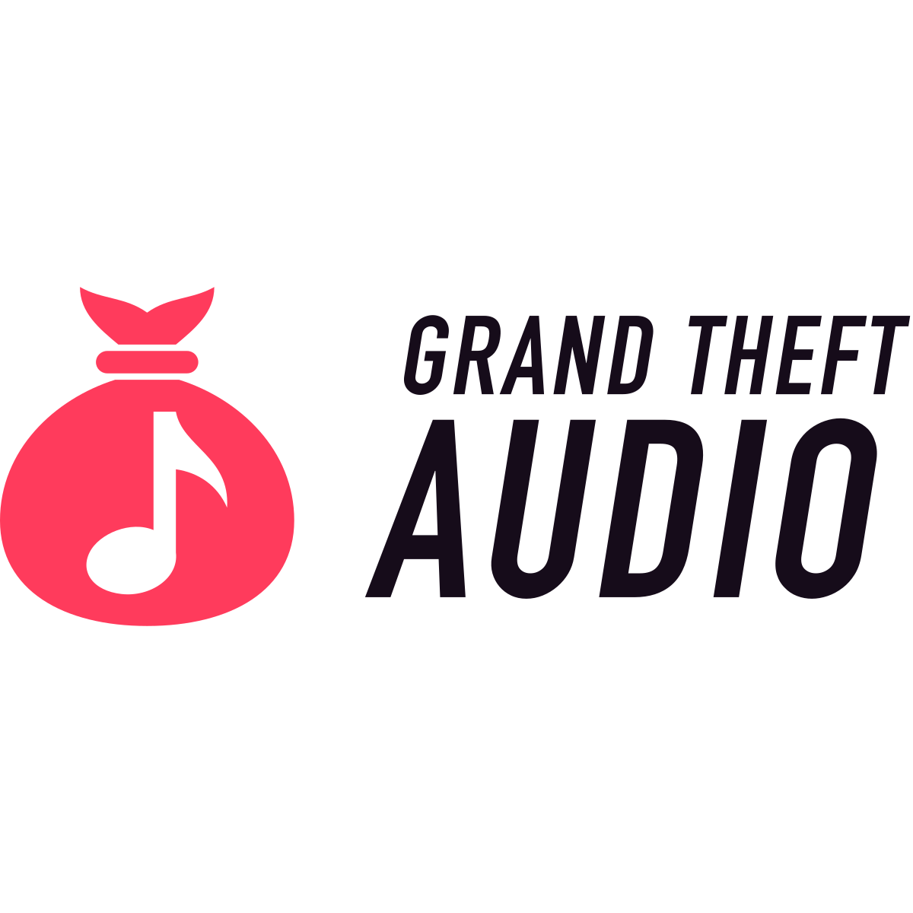

# Grand Theft Audio — Logo Guidelines

## 1. The logo

**Idea:** the cartoon burglar's loot sack, with a music note where the $ should be. Stolen goods, but it's music.
That's the whole product in one glance: hear a song, lift it, keep it.

| Version | File (`logo/`) | Use it for |
|---|---|---|
| Horizontal (primary) | `gta-horizontal-color.svg` | README headers, web pages, anything wide |
| Stacked | `gta-stacked-color.svg` | Square spaces: posters, stickers, splash screens |
| Symbol | `gta-symbol-color.svg` | Icons, avatars, anywhere the name is already nearby |
| Symbol, small size | `gta-symbol-small.svg` | 24 px and below (tie and tuft merged into one silhouette, larger note) |
| Wordmark | `gta-wordmark.svg` | Rare: when the sack is already on screen |

Every version also comes as `-reversed` (heat sack + white words, for ink backgrounds), `-white`, `-mono-ff3b5c`
(all heat) and plain black (the file without a suffix). Ready-made PNGs (1200 px) are in `png/`.

## 2. Clear space

Keep a clear zone of **1 × K** on all sides, where **K is the height of the knot** (tuft + tie, from the top of the
tuft to the top of the sack's body). That's about a quarter of the symbol's height. The zone scales with the logo.

## 3. Minimum size

| Version | Screen | Print |
|---|---|---|
| Horizontal | 140 px wide | 30 mm wide |
| Stacked | 64 px wide | 15 mm wide |
| Symbol | 24 px (16 px with `gta-symbol-small.svg` / `icons/favicon.svg`) | 6 mm |

## 4. Colour

| Name | HEX | RGB | CMYK (approx.) | Pantone (nearest) |
|---|---|---|---|---|
| **Heat** (primary) | `#FF3B5C` | 255 59 92 | 0 77 64 0 | 1787 C |
| **Getaway Ink** | `#160C1A` | 22 12 26 | 70 80 60 85 | Black 6 C |
| White | `#FFFFFF` | 255 255 255 | 0 0 0 0 | — |

Both come from the app's own window palette (`ytprogress.swift`, `Ink`): heat is the label and glow colour, ink is the caption field.
CMYK and Pantone values are starting points. Check them against a printed swatch before a print run.

**Contrast:** heat on ink 5.5:1 · ink on white 19:1 · heat on white 3.5:1 (fine for the logo, too low for small text,
so set body copy in ink, never heat).

**Approved pairs:** heat sack + ink words on white · heat sack + white words on ink · all white on heat · all black
or all white for one-colour jobs (stamps, engraving, single-colour print).

## 5. Typography

- **Wordmark:** DIN Condensed Bold, slanted 9°, "GRAND THEFT" over a larger "AUDIO" justified to the same width.
  It's outlined in every logo file, so you never need the font to use the logo.
- **Text next to the logo:** SF Pro (the macOS system font), Medium/Semibold for headings, Regular for copy.
- **Licence:** DIN Condensed Bold ships with macOS. Apple's font licence was not checked for logo use. Before a
  commercial or public launch, license DIN Condensed from its foundry or redraw the wordmark.

## 6. Don'ts

Don't stretch or squash · don't recolour outside the palette (no GTA-style white boxes, no dollar green) · don't
rotate or flip the sack · don't add shadows, outlines or gradients to the logo (the plum glow belongs to the
*background* of the app icon and thumbnail, not to the mark) · don't move or resize the parts of a lockup · don't
put it on busy photos without an ink or heat panel · don't type the wordmark out in a font.

## 7. Files

| Folder | Contents |
|---|---|
| `logo/` | SVG masters and colour variants |
| `png/` | 1200 px PNGs of the main versions (transparent) |
| `icons/` | `favicon.ico/.svg`, PNG icons (16–512), `apple-touch-icon.png`, `maskable-512.png`, `site.webmanifest`, `head-snippet.html` |
| `icon/` | macOS app icon: `GrandTheftAudio.icns` and `icon-1024.png` |
| `presentation/` | `board.html` and `slides/` (brief, logo, mockups) |
| `build_logo.py` | Rebuilds `logo/` masters (`pip3 install fonttools && python3 brand/build_logo.py`) |
| `make_art.py` | Rebuilds the app icon and `thumbnail.png` (the README's header image) from the masters |

## 8. Handover notes

- **Construction:** 256-unit grid. The sack's body, the note and the knot are filled paths. The note is a real hole
  (`evenodd`), so one-colour versions work on any background. The symbol is lifted 4 units above centre for optical
  balance. There are no strokes, live text, filters or rasters anywhere.
- **Tests run:** 16/24/32/64 px renders (the small cut keeps the sack and note at 16 px), favicon on light and dark
  tabs, one-colour black/white, reversed on ink, and the audit script (symbol files 100/100; the only wordmark
  warnings are DIN's own 88° letter strokes).
- **Open items:** trademark search (the name parodies *Grand Theft Auto*; the logo deliberately borrows none of its
  look) · font licence (see §5) · Pantone check on paper.
